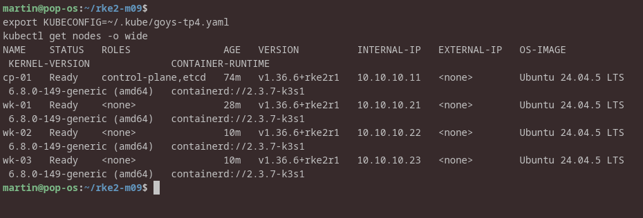
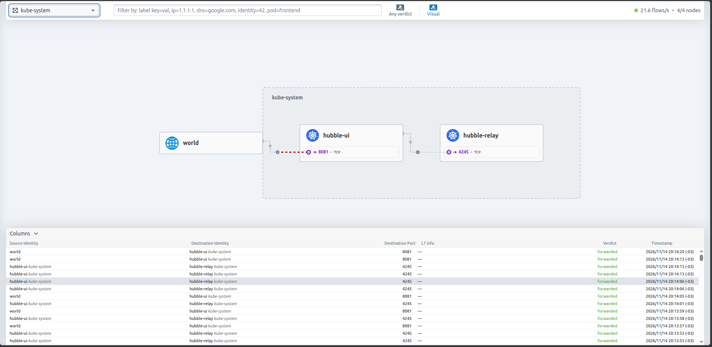

# Etapa 5 — Cluster RKE2: server en `cp-01` y agents en `wk-01..03`

**Responsable:** Martín Espamer · **Fecha:** 14/11/2026

**Listo cuando (M08, #23):** el API server responde, los Secrets están cifrados, el audit log escribe eventos y el token del nodo no sale del servidor.

**Listo cuando (M09, #24):** `wk-01`, `wk-02` y `wk-03` registrados en el cluster.

**Listo cuando (M16, #31):** pods de ArgoCD `Running` en el namespace `argocd`.

**Listo cuando (M17, #32):** la UI de ArgoCD abre por WARP y no desde internet.

**Listo cuando (M18, #33):** los 4 integrantes entran a la UI de ArgoCD con su usuario.

**Listo cuando (M19, #34):** el repo del grupo aparece `Successful` en ArgoCD.

**Listo cuando (M20, #35):** las Applications `hardening`, `app` y `cloudflared` aparecen en la UI de ArgoCD.

**Listo cuando (M21, #37):** un cambio manual pasa a `OutOfSync` y ArgoCD lo revierte solo.

## Reinstalar desde cero (R17)

Orden para rehacer el cluster (base del playbook de R17). Cada paso remite a su sección.

| # | Dónde | Paso |
|---|-------|------|
| 1 | `cp-01` | [Instalación](#instalación) con versión fija `v1.36.6+rke2r1` y `INSTALL_RKE2_TYPE=server` |
| 2 | `cp-01` | [Preparación CIS](#preparación-para-el-perfil-cis): usuario `etcd` y sysctl |
| 3 | `cp-01` | [Configuración](#configuración): `config.yaml`, `audit-policy.yaml` y `rke2-cilium-config.yaml`, **antes** del primer arranque |
| 4 | `cp-01` | [Arranque](#arranque): `systemctl enable --now rke2-server` y esperar el nodo `Ready` |
| 5 | notebook | [kubectl desde la notebook](#kubectl-desde-la-notebook) |
| 6 | workers | [Agents](#agents-en-wk-0103-m09): instalación con `INSTALL_RKE2_TYPE=agent`, sysctl CIS, `config.yaml` y [token](#token) por pipe SSH. Arrancar `wk-01` primero |
| 7 | notebook | [Verificación del cluster](#verificación-del-cluster-m10) |
| 8 | notebook | `kubectl apply -f k8s/cilium/hubble-ui-policy.yaml` ([Hubble](#hubble-m11)) |
| 9 | notebook | CRDs de Gateway API, reinicio de operator y agentes, y `k8s/gateway-api/gateway.yaml` ([Gateway API](#gateway-api-m13)) |
| 10 | notebook | `kubectl apply -f k8s/rbac/integrantes.yaml` y certificados nuevos ([Acceso por integrante](#acceso-por-integrante-m14)) |
| 11 | notebook | Namespace e instalación de ArgoCD `v3.6.1`, cambio de la contraseña de `admin` ([ArgoCD](#argocd-m16)) |
| 12 | notebook | `kubectl apply -f k8s/argocd/server-nodeport.yaml` ([UI de ArgoCD](#ui-de-argocd-por-warp-m17)) |
| 13 | notebook | `kubectl apply -f k8s/argocd/repo-goys.yaml` ([Repo en ArgoCD](#repo-del-grupo-en-argocd-m19)) |
| 14 | notebook | Parche de health en `argocd-cm` y `kubectl apply -f k8s/argocd/root.yaml` ([Applications](#applications-de-argocd-m20)). Desde acá ArgoCD aplica todo lo demás |
| 15 | notebook | Parches de cuentas (`argocd-cm`) y permisos (`argocd-rbac-cm`), contraseñas con `argocd account update-password` ([Usuarios](#usuarios-de-argocd-m18)) |

En una reinstalación, Hubble y Gateway API ya van en el `HelmChartConfig` del paso 3. Los CRDs de Gateway API tienen que estar antes de que arranque el operator; si no, Cilium desactiva el soporte y hay que reiniciar el operator después de aplicarlos (paso 9). Una CA nueva invalida los kubeconfig anteriores: hay que generar certificados nuevos para cada integrante.

Valores que no se publican: el `node-token` de `cp-01` (`token: <token>` en el `config.yaml` de los agents) y los kubeconfig.

## Diseño

| Pieza | Elección | Motivo |
|-------|----------|--------|
| Distribución | RKE2 `v1.36.6+rke2r1` (canal `stable` al 14/11), versión fija | Los 4 nodos con la misma versión aunque M09 se haga otro día |
| Perfil | `profile: cis` | Flags del CIS Benchmark en apiserver, kubelet y etcd, y PSA `restricted` por defecto |
| CNI | Cilium (chart `rke2-cilium-1.20.400`) sin kube-proxy | Services por eBPF, NetworkPolicies, Hubble (M11) y Gateway API (M13) |
| Secrets | Cifrado en etcd (AES-CBC) | Una copia de etcd no expone las claves |
| Audit log | Política propia | Sin política no se registra nada; con todo en `RequestResponse` los Secrets quedan en el log |
| Ingress | Ninguno (`rke2-traefik` y `rke2-traefik-crd` desactivados) | La app sale por el túnel y el tráfico de entrada va por Gateway API de Cilium en M13 |

## Instalación

El instalador se descarga y se revisa antes de ejecutarlo (en vez de `curl | sh`). En Ubuntu instala por tarball en `/usr/local` y no arranca el servicio.

```bash
# root@cp-01
curl -sL -o /dev/null -w '%{url_effective}\n' https://update.rke2.io/v1-release/channels/stable
curl -sfL https://get.rke2.io -o /root/install-rke2.sh
INSTALL_RKE2_VERSION="v1.36.6+rke2r1" INSTALL_RKE2_TYPE=server sh /root/install-rke2.sh
```

### Preparación para el perfil CIS

Con `profile: cis` RKE2 no arranca si falta el usuario `etcd` o si el kernel no tiene los valores que exige el kubelet (`--protect-kernel-defaults`). Con el método tarball el archivo de sysctl está en `/usr/local/share/rke2/`, no en `/usr/share/rke2/`.

```bash
useradd -r -c "etcd user" -s /sbin/nologin -M -U etcd
cp /usr/local/share/rke2/rke2-cis-sysctl.conf /etc/sysctl.d/60-rke2-cis.conf
systemctl restart systemd-sysctl
```

| Parámetro | Valor | Efecto |
|-----------|-------|--------|
| `vm.panic_on_oom` | 0 | Sin RAM, el OOM killer mata un proceso en vez de colgar el nodo |
| `vm.overcommit_memory` | 1 | Permite reservar más memoria de la física, como asume Kubernetes |
| `kernel.panic` | 10 | Tras un kernel panic, reinicia a los 10 s |
| `kernel.panic_on_oops` | 1 | Un oops se trata como panic |

## Configuración

Los tres archivos se escriben antes del primer arranque: el perfil y el CNI se fijan al crear el cluster.

`/etc/rancher/rke2/config.yaml` (permiso `600`):

```yaml
profile: cis
cni: cilium
disable-kube-proxy: true
secrets-encryption: true
node-ip: 10.10.10.11
tls-san:
  - 10.10.10.11
  - cp-01
write-kubeconfig-mode: "0600"
audit-policy-file: /etc/rancher/rke2/audit-policy.yaml
disable:
  - rke2-traefik
  - rke2-traefik-crd
```

`secrets-encryption` ya viene activo en RKE2; se deja explícito. `tls-san` agrega la IP y el nombre al certificado del apiserver para usar `kubectl` desde la notebook por WARP.

### Política de audit

`/etc/rancher/rke2/audit-policy.yaml` (permiso `600`). Las reglas se evalúan en orden y gana la primera que coincide.

```yaml
apiVersion: audit.k8s.io/v1
kind: Policy
omitStages:
  - RequestReceived
rules:
  # 1. Ruido: chequeos de salud y métricas
  - level: None
    nonResourceURLs:
      - /healthz*
      - /readyz*
      - /livez*
      - /version
      - /metrics
  # 2. Ruido: leases (latidos de los componentes) y events
  - level: None
    resources:
      - group: "coordination.k8s.io"
        resources: ["leases"]
      - group: ""
        resources: ["events"]
  # 3. Ruido: lecturas que hacen los nodos (kubelet)
  - level: None
    userGroups: ["system:nodes"]
    verbs: ["get", "list", "watch"]
  # 4. Datos sensibles: solo quién y cuándo, nunca el contenido
  - level: Metadata
    resources:
      - group: ""
        resources: ["secrets", "configmaps", "serviceaccounts/token"]
      - group: "authentication.k8s.io"
        resources: ["tokenreviews"]
  # 5. Cambios: guardar qué se pidió cambiar
  - level: Request
    verbs: ["create", "update", "patch", "delete", "deletecollection"]
  # 6. Todo lo demás (lecturas normales): metadata
  - level: Metadata
```

La regla 4 va antes que la 5: si no, crear un Secret quedaría en nivel `Request` con el valor en el log. El perfil CIS define el destino (`/var/lib/rancher/rke2/server/logs/audit.log`) y la rotación (100 MB × 10 archivos, 30 días).

### Cilium

`/var/lib/rancher/rke2/server/manifests/rke2-cilium-config.yaml`. El helm-controller de RKE2 lo aplica sobre el chart `rke2-cilium`; tiene que llamarse así y estar en `kube-system`.

```yaml
apiVersion: helm.cattle.io/v1
kind: HelmChartConfig
metadata:
  name: rke2-cilium
  namespace: kube-system
spec:
  valuesContent: |-
    kubeProxyReplacement: true
    k8sServiceHost: 10.10.10.11
    k8sServicePort: 6443
    operator:
      replicas: 1
    hubble:            # M11
      enabled: true
      relay:
        enabled: true
      ui:
        enabled: true
        service:
          type: NodePort
          nodePort: 31235
    gatewayAPI:        # M13
      enabled: true
      hostNetwork:
        enabled: true
```

Sin kube-proxy, el Service `kubernetes` lo implementa el propio Cilium, así que Cilium necesita la dirección real del apiserver (`k8sServiceHost`/`k8sServicePort`). Un solo `cilium-operator` alcanza para el lab y ahorra RAM en `cp-01`.

## Arranque

```bash
systemctl enable --now rke2-server
journalctl -u rke2-server -f
```

Tarda unos minutos la primera vez (descarga de imágenes). En el log se ve la generación del certificado con los SAN, el borrado de los manifests de otros CNI y la instalación de cada chart con un Job `helm-install-*`. Los Jobs de `snapshot-controller` muestran reinicios: esperan a que su chart de CRDs termine y luego completan.

Para `kubectl` en el nodo (solo root):

```bash
# /root/.bashrc
export KUBECONFIG=/etc/rancher/rke2/rke2.yaml
export PATH=$PATH:/var/lib/rancher/rke2/bin
```

### Traefik y CRDs de Gateway API

RKE2 1.36 instala traefik como ingress por defecto (DaemonSet en cada nodo, puertos 80/443). Se desactivó con `disable:` y un reinicio de `rke2-server`, antes de sumar los workers.

Al desinstalar `rke2-traefik-crd` quedaron 10 CRDs de Gateway API (`bundle-version: v1.6.3`, canal `standard`) con `helm.sh/resource-policy: keep` y sin dueño. Se borraron a mano después de comprobar que no había objetos de esos tipos:

```bash
kubectl get gatewayclasses,gateways,httproutes,grpcroutes,tlsroutes,tcproutes,udproutes,referencegrants -A   # No resources found
kubectl get crd -o name | grep 'gateway.networking.k8s.io' | xargs kubectl delete
```

En M13 se instalan los CRDs de Gateway API en la versión que soporte Cilium 1.20, como manifest propio en el repo y no atados a un chart.

## Pod Security Admission

El perfil CIS genera `/etc/rancher/rke2/rke2-pss.yaml` con `enforce`, `audit` y `warn` en `restricted` (`latest`) para todo el cluster. Exentos: `kube-system`, `compliance-operator-system` y `tigera-operator` (los dos últimos vienen en la plantilla y no se usan).

Todo namespace nuevo (app, ArgoCD en M16, Sealed Secrets) tiene que cumplir `restricted`: `runAsNonRoot: true`, `allowPrivilegeEscalation: false`, `capabilities.drop: ["ALL"]` y `seccompProfile.type: RuntimeDefault`. Se prueba sin crear nada con `--dry-run=server`:

```
$ kubectl run psa-test --image=nginx -n default --dry-run=server
Error from server (Forbidden): pods "psa-test" is forbidden: violates PodSecurity "restricted:latest": allowPrivilegeEscalation != false (...), unrestricted capabilities (...), runAsNonRoot != true (...), seccompProfile (...)
```

## kubectl desde la notebook

El kubeconfig de RKE2 es la credencial de `system:admin`. Se copia una vez por un archivo temporal que se borra enseguida, y en la notebook queda fuera del repo con permiso `600`.

```bash
# root@cp-01
install -o goys -g goys -m 600 /etc/rancher/rke2/rke2.yaml /home/goys/rke2.yaml
# notebook (kubectl v1.36.6, binario verificado con su .sha256)
scp goys@10.10.10.11:rke2.yaml ~/.kube/goys-tp4.yaml
ssh goys@10.10.10.11 rm rke2.yaml
chmod 600 ~/.kube/goys-tp4.yaml
sed -i 's#https://127.0.0.1:6443#https://10.10.10.11:6443#' ~/.kube/goys-tp4.yaml
KUBECONFIG=~/.kube/goys-tp4.yaml kubectl get nodes
```

## Verificación

| Prueba | Resultado |
|--------|-----------|
| `systemctl is-active rke2-server` | `active` |
| `kubectl get nodes` | `cp-01 Ready control-plane,etcd v1.36.6+rke2r1` |
| `kubectl get --raw /readyz` | `ok` |
| `rke2 secrets-encrypt status` | `Encryption Status: Enabled`, clave `AES-CBC`, `All hashes match` |
| `cilium-dbg status` (en el pod de Cilium) | `KubeProxyReplacement: True [eth0 10.10.10.11 (Direct Routing)]` |
| `kubectl get pods -A` | Sin `kube-proxy`; control plane, Cilium, CoreDNS, metrics-server y snapshot-controller en `Running` |
| `ls -l .../logs/audit.log` | `-rw------- root root`, escribiendo |
| Secret de prueba: create / get / delete | Los tres eventos en el audit log, nivel `Metadata`, usuario `system:admin` |
| Valor del Secret de prueba en el audit log (texto plano y base64) | 0 apariciones |
| `ls -lL /var/lib/rancher/rke2/server/node-token` | `-rw------- root root`. No se copia a ningún lado |
| `kubectl get nodes` desde la notebook por WARP | `cp-01 Ready` |

## Agents en `wk-01..03` (M09)

### Red entre nodos

Antes de instalar se revisó si algo filtra el tráfico entre las VMs:

- **Firewall de Proxmox:** activo a nivel datacenter (`cluster.fw` con `enable: 1` y `policy_in: DROP`), pero esa política protege al host. No hay `<VMID>.fw` para 111 ni para 121–123, así que el firewall de las VMs está apagado y `firewall=1` en la placa no aplica reglas.
- **Dentro de Ubuntu:** `ufw` inactivo.
- **Prueba desde `wk-01`:** `ping` a `cp-01` sin pérdida y `nc -zv` a 9345 (supervisor) y 6443 (API) con `succeeded`.

Los puertos entre todos los nodos (10250 kubelet, 8472/udp VXLAN y 4240 health de Cilium) se validan al final con `cilium-health`.

### Instalación

El mismo `install.sh` se bajó una vez en la notebook, se revisó y se copió a cada worker (sha256 `45f5c14cd04aa3de4b164d5a7412113ab415bebbe5cbaa952448a5dabb57876a`, 765 líneas). Instala por tarball en `/usr/local` y verifica el checksum del tarball antes de descomprimirlo.

```bash
# notebook
curl -sfL https://get.rke2.io -o install.sh
for ip in 21 22 23; do
  scp install.sh goys@10.10.10.$ip:/tmp/install.sh
  ssh goys@10.10.10.$ip 'sudo INSTALL_RKE2_VERSION=v1.36.6+rke2r1 INSTALL_RKE2_TYPE=agent sh /tmp/install.sh'
done
```

### Preparación CIS y configuración

Los sysctls CIS hacen falta en cada worker: con `profile: cis` el kubelet corre con `--protect-kernel-defaults` y no arranca si el kernel no tiene esos valores. El usuario `etcd` no se crea en los agents porque etcd solo corre en el server.

```bash
# en cada worker
cp /usr/local/share/rke2/rke2-cis-sysctl.conf /etc/sysctl.d/60-rke2-cis.conf
systemctl restart systemd-sysctl
```

`/etc/rancher/rke2/config.yaml` (permiso `600`, dueño root):

```yaml
server: https://10.10.10.11:9345
profile: cis
node-ip: 10.10.10.21   # .22 y .23 en wk-02 y wk-03
token: <token>   # node-token de cp-01, ver Token
```

Audit, cifrado, `tls-san` y Cilium no van en el agent: son del control plane, y el server despliega Cilium en cada nodo como DaemonSet.

### Token

El `node-token` (`K10<hash de la CA>::server:<secreto>`) es la credencial para sumar nodos. El hash de la CA le permite al agent comprobar que habla con el `cp-01` real. Se pasa de `cp-01` a cada worker con un pipe SSH a SSH, sin mostrarlo en pantalla ni guardarlo en la notebook:

```bash
ssh goys@10.10.10.11 'sudo cat /var/lib/rancher/rke2/server/node-token' \
  | ssh goys@10.10.10.21 'sed "s/^/token: /" | sudo tee -a /etc/rancher/rke2/config.yaml >/dev/null'
```

Solo queda en `/var/lib/rancher/rke2/server/node-token` en `cp-01` y en el `config.yaml` de cada worker, con permiso `600` y dueño root. Para comprobarlo sin mostrarlo: `grep -c '^token: K10'` da `1`.

### Arranque

Primero `wk-01` solo, para ver errores en un nodo y medir la RAM de `cp-01`. Después `wk-02` y `wk-03` juntos.

```bash
systemctl enable --now rke2-agent
```

El nodo aparece `NotReady` hasta que Cilium arranca en él (menos de un minuto). Con `wk-01` unido, `cp-01` tenía 2385 MB `available`.

`ROLES <none>` en los workers es normal: RKE2 solo etiqueta los roles del server.

### Verificación

| Prueba | Resultado |
|--------|-----------|
| `systemctl is-active rke2-agent` (3 workers) | `active` |
| `rke2 --version` (3 workers) | `v1.36.6+rke2r1`, mismo commit que el server |
| `kubectl get nodes -o wide` | 4 nodos `Ready`, `v1.36.6+rke2r1`, INTERNAL-IP `.11`, `.21`, `.22` y `.23` |
| `kubectl -n kube-system get pods -l k8s-app=cilium -o wide` | 4 pods `Running` (uno por nodo), 0 reinicios. Sin `kube-proxy` en los workers |
| `cilium-health status` | `4/4 reachable`, `1/1` en Node (ICMP y 4240) y en Endpoints (VXLAN 8472) para los 4 nodos |
| CoreDNS | Segunda réplica en `wk-01` con IP de pod `10.42.1.x`: cada nodo tiene su propio rango de pods |

## Verificación del cluster (M10)

Control de salud con los 4 nodos unidos, antes de montar el resto encima.

### Nodos

```
$ kubectl get nodes -o wide
NAME    STATUS   ROLES                AGE   VERSION          INTERNAL-IP   EXTERNAL-IP   OS-IMAGE             KERNEL-VERSION              CONTAINER-RUNTIME
cp-01   Ready    control-plane,etcd   74m   v1.36.6+rke2r1   10.10.10.11   <none>        Ubuntu 24.04.5 LTS   6.8.0-149-generic (amd64)   containerd://2.3.7-k3s1
wk-01   Ready    <none>               28m   v1.36.6+rke2r1   10.10.10.21   <none>        Ubuntu 24.04.5 LTS   6.8.0-149-generic (amd64)   containerd://2.3.7-k3s1
wk-02   Ready    <none>               10m   v1.36.6+rke2r1   10.10.10.22   <none>        Ubuntu 24.04.5 LTS   6.8.0-149-generic (amd64)   containerd://2.3.7-k3s1
wk-03   Ready    <none>               10m   v1.36.6+rke2r1   10.10.10.23   <none>        Ubuntu 24.04.5 LTS   6.8.0-149-generic (amd64)   containerd://2.3.7-k3s1
```



### `kube-system`

```bash
kubectl -n kube-system get pods -o wide
kubectl -n kube-system get pods --field-selector=status.phase!=Running,status.phase!=Succeeded   # No resources found
```

- **Cilium:** 4 pods `cilium` (uno por nodo, con la IP del nodo porque usan la red del host) y `cilium-operator` con 1 réplica. 0 reinicios.
- **CoreDNS:** 2 réplicas en nodos distintos (`cp-01` y `wk-01`) y el autoscaler.
- **metrics-server** y **snapshot-controller** `Running`. Sin `kube-proxy`.
- Los `helm-install-rke2-*` quedan en `Completed`: son los jobs que instalaron los charts. El de `snapshot-controller` tuvo 2 reinicios al arrancar, mientras esperaba los CRDs que instala el otro job.

`kubectl top nodes` responde con datos de los 4 nodos, así que metrics-server llega a todos los kubelets:

```
NAME    CPU(cores)   CPU(%)   MEMORY(bytes)   MEMORY(%)
cp-01   124m         6%       2065Mi          52%
wk-01   25m          1%       495Mi           16%
wk-02   20m          1%       505Mi           17%
wk-03   19m          0%       480Mi           16%
```

`cp-01` ya usa la mitad de su memoria con el control plane solo. Hay que seguirlo cuando entren ArgoCD y el resto.

### Cilium y kube-proxy

```bash
for p in $(kubectl -n kube-system get pods -l k8s-app=cilium -o name); do
  kubectl -n kube-system exec $p -c cilium-agent -- cilium-dbg status \
    | grep -E 'KubeProxyReplacement|Cluster health|Controller Status|Kubernetes:|Cilium:'
done
```

En los 4 agentes: `Kubernetes: Ok`, `Cilium: Ok 1.20.4`, `KubeProxyReplacement: True [eth0 10.10.10.x (Direct Routing)]` con la IP de cada nodo, `Controller Status` todo `healthy` y `Cluster health: 4/4 reachable`.

### DNS desde un pod

Pod `busybox:1.36.1` en un namespace de prueba `m10-dns-test`. El namespace **no está exento** de PSA, así que el pod también prueba que un `securityContext` que cumple `restricted` es aceptado: `runAsNonRoot`, usuario 65534, `seccompProfile: RuntimeDefault`, `allowPrivilegeEscalation: false`, `capabilities.drop: ["ALL"]` y `readOnlyRootFilesystem`. Quedó `Running` en `wk-03` (IP `10.42.4.6`).

`/etc/resolv.conf` del pod:

```
search m10-dns-test.svc.cluster.local svc.cluster.local cluster.local lab.internal
nameserver 10.43.0.10
options ndots:5
```

| Prueba | Resultado |
|--------|-----------|
| `nslookup kubernetes.default` | `NXDOMAIN` (ver nota) |
| `nslookup kubernetes.default.svc.cluster.local` | `10.43.0.1`, respondido por `10.43.0.10` |
| `wget https://kubernetes.default` | `Connecting to kubernetes.default (10.43.0.1:443)`: el nombre corto resuelve y la conexión TCP llega a la API |

Nota: el `nslookup` de busybox usa su propio cliente DNS y no aplica la línea `search`, así que consulta `kubernetes.default.` literal y CoreDNS responde, con razón, que no existe. Las aplicaciones usan el resolver de la libc, que sí completa con `search`, y ese caso es el que prueba `wget`. Para repetir la prueba con busybox, usar el nombre completo.

`lab.internal` en `search` no lo agrega Kubernetes: viene del `resolv.conf` de los nodos.

Al terminar se borró el namespace (y con él el pod): `kubectl delete namespace m10-dns-test`. Después, `kubectl get namespace m10-dns-test` da `NotFound`.

## Hubble (M11)

Hubble registra los flujos que ve Cilium en cada nodo: origen, destino, puerto y si el paquete pasó (`FORWARDED`) o se bloqueó (`DROPPED`, con el motivo). El **relay** junta los flujos de los 4 nodos y la **UI** los dibuja. Es la evidencia de las NetworkPolicies (R13, R15).

### Activación

Se agregó el bloque `hubble` al `HelmChartConfig` de Cilium (ver [Cilium](#cilium)). Desde la notebook, sin dejar el archivo en ningún lado:

```bash
ssh goys@10.10.10.11 'sudo tee /var/lib/rancher/rke2/server/manifests/rke2-cilium-config.yaml >/dev/null' <<'EOF'
...
EOF
```

RKE2 detecta el cambio y vuelve a aplicar el chart. En menos de un minuto quedan `hubble-relay` (1/1) y `hubble-ui` (2/2) en `Running`, y el Service `hubble-ui` como `NodePort 80:31235/TCP`.

### Acceso a la UI

La UI no tiene login, así que no se publica por el quick tunnel. Queda como NodePort en las IPs de los nodos, que solo se alcanzan desde `10.10.10.0/24`, es decir, por WARP con un mail del grupo. Es de solo lectura: muestra flujos pero no permite cambiar nada del cluster.

Con el NodePort solo no alcanza. El perfil CIS crea en `kube-system` la NetworkPolicy `default-network-policy`, que solo admite tráfico del mismo namespace, y Hubble mostró el rechazo:

```
10.10.10.5:42890 (world) <> kube-system/hubble-ui-...:8081 policy-verdict:none INGRESS DENIED (TCP Flags: SYN)
10.10.10.5:42890 (world) <> kube-system/hubble-ui-...:8081 Policy denied DROPPED (TCP Flags: SYN)
```

La política de RKE2 no se toca (la regenera RKE2). Se agrega una excepción solo para la UI: [`k8s/cilium/hubble-ui-policy.yaml`](../k8s/cilium/hubble-ui-policy.yaml), una `CiliumNetworkPolicy` que abre el puerto 8081 de `hubble-ui` desde `10.10.10.0/24` (acceso directo al nodo del pod, por ejemplo desde `cf-admin`) y desde `remote-node` (NodePort de otro worker, que reenvía el paquete con su propia identidad).

```bash
kubectl apply -f k8s/cilium/hubble-ui-policy.yaml
```

URL: `http://10.10.10.21:31235` (o `.22`, `.23`). Por `cp-01` no responde: Cilium clasifica como `world` el tráfico que reenvía desde ese nodo y la política no lo admite. Para la UI se usan las IPs de los workers.

### CLI

`hubble` v1.20.4 en la notebook, verificado con su `.sha256sum`. `kubectl port-forward` al relay cumple la función de `cilium hubble port-forward` sin instalar también el CLI de Cilium:

```bash
kubectl -n kube-system port-forward svc/hubble-relay 4245:80 >/dev/null &
hubble status --server localhost:4245
hubble observe --server localhost:4245 --last 20
```

### Verificación

| Prueba | Resultado |
|--------|-----------|
| `hubble status` | `Healthcheck: Ok`, `Connected Nodes: 4/4`, ~23 flows/s |
| `hubble observe --last 20` | Health de Cilium (4240), workers → API (6443/9345), metrics-server → kubelets (10250), relay → nodos (4244). Todo `FORWARDED` |
| `curl` a `10.10.10.21:31235` y `.22`, `.23` | `200` |
| UI por WARP, namespace `kube-system` | Mapa `world → hubble-ui → hubble-relay` con flujos `forwarded` y `4/4 nodes` |

El mapa por ahora tiene solo esos tres elementos porque dibuja tráfico entre pods, y el resto del tráfico de sistema es de los nodos. Se llena cuando esté la app (api → redis).



## Gateway API (M13)

El Gateway es la puerta de entrada HTTP a la app: la `HTTPRoute` de R07 se engancha a él y el quick tunnel (R09) le apunta. Lo implementa el Envoy que va dentro de cada agente de Cilium.

### CRDs

Gateway API v1.6.3, canal *standard*: la versión que soporta Cilium 1.20 (la misma que traía `rke2-traefik-crd` y se borró en M08). El bundle oficial está en el repo, en [`k8s/gateway-api/standard-install.yaml`](../k8s/gateway-api/standard-install.yaml) (sha256 `356c2b8e286a964dc20995435659ad1095386329974793af10bbfe3eff977fe5`). Trae 10 CRDs y la `ValidatingAdmissionPolicy` `safe-upgrades`, que impide pisarlos con una versión anterior o experimental.

```bash
curl -sfL -o k8s/gateway-api/standard-install.yaml \
  https://github.com/kubernetes-sigs/gateway-api/releases/download/v1.6.3/standard-install.yaml
kubectl apply --server-side -f k8s/gateway-api/standard-install.yaml
```

Van antes de activar Gateway API en Cilium: si al arrancar no los encuentra, desactiva el soporte. `--server-side` porque los CRDs superan el límite de tamaño de la anotación del apply normal.

### Cilium

Bloque `gatewayAPI` con `hostNetwork.enabled` en el `HelmChartConfig` (ver [Cilium](#cilium)), aplicado igual que en M11. Después se reinician operator y agentes:

```bash
kubectl -n kube-system get cm cilium-config -o yaml | grep enable-gateway-api   # esperar "true"
kubectl -n kube-system rollout restart deployment/cilium-operator
kubectl -n kube-system rollout restart ds/cilium
```

El orden importa. La primera vez el operator se reinició antes de que RKE2 actualizara `cilium-config`, arrancó sin Gateway API y no registró los CRDs `ciliumenvoyconfigs` y `ciliumclusterwideenvoyconfigs`. Los agentes nuevos de `wk-01` y `wk-03` quedaron `0/1` con `Still waiting for Cilium Operator to register CRDs`. Se resolvió reiniciando solo el operator: creó los dos CRDs y los agentes terminaron de arrancar solos.

### Gateway

[`k8s/gateway-api/gateway.yaml`](../k8s/gateway-api/gateway.yaml): namespace `gateway` con PSA `restricted` (no tiene pods) y el Gateway `goys-gateway` con un listener HTTP en el puerto `8000`. Solo acepta rutas del namespace `app` (`allowedRoutes` por `kubernetes.io/metadata.name`). Nombre y namespace coinciden con los `parentRefs` de [`k8s/app/httproute.yaml`](../k8s/app/httproute.yaml).

En host network el Envoy de cada nodo escucha en `<IP del nodo>:8000`. Se eligió sobre LB IPAM + L2 announcements por tener menos piezas (ver [decisiones](decisiones.md)). El puerto es alto porque Envoy no tiene la capability para abrir puertos menores a 1024. Cilium también crea el Service `cilium-gateway-goys-gateway` (`NodePort 8000:32216`), al que puede apuntar `cloudflared` desde dentro del cluster.

### Verificación

| Prueba | Resultado |
|--------|-----------|
| `kubectl get crd \| grep gateway.networking.k8s.io` | 10 CRDs |
| `kubectl get gatewayclass` | `cilium io.cilium/gateway-controller ACCEPTED True` |
| `kubectl get gateway -A` | `goys-gateway cilium 10.10.10.11 PROGRAMMED True` |
| `rollout status ds/cilium` | 4/4 agentes actualizados |
| `curl http://10.10.10.21:8000/` | `404`: Envoy responde y todavía no hay rutas |

## Acceso por integrante (M14)

Cada integrante tiene su propio usuario de `kubectl`, para que el audit log registre quién hizo cada cosa. Es un certificado cliente firmado por la CA del cluster: el `CN` del certificado es el nombre de usuario.

| Pieza | Elección | Motivo |
|-------|----------|--------|
| Usuarios | `facundo`, `agustin`, `manuel`, `baltazar` | `CN=<nombre>`, sin `O=` (ningún grupo extra) |
| Permisos | `ClusterRoleBinding` a `cluster-admin` por usuario ([`k8s/rbac/integrantes.yaml`](../k8s/rbac/integrantes.yaml)) | Casi todas las tareas instalan o crean recursos de todo el cluster |
| Vencimiento | 60 días (`expirationSeconds: 5184000`), vence el 13/01/2027 | Un certificado no se puede revocar; vence solo |
| Revocación | Borrar el binding del usuario | El permiso está atado al nombre, no a un grupo |
| Server | `https://10.10.10.11:6443` | Solo llega con WARP conectado |

Las claves las generó Martín y cada kubeconfig se entregó por WhatsApp, porque el resto del grupo no estaba disponible (ver [decisiones.md](decisiones.md)). Después de entregarlos se borraron los mensajes y las copias locales.

### Generación y firma

```bash
# notebook de Martín, con el kubeconfig de admin
export KUBECONFIG=~/.kube/goys-tp4.yaml
mkdir -p -m 700 ~/.kube/goys-entrega && cd ~/.kube/goys-entrega
kubectl config view --raw -o jsonpath='{.clusters[0].cluster.certificate-authority-data}' | base64 -d > ca.crt

for N in facundo agustin manuel baltazar; do
  openssl req -new -newkey ec -pkeyopt ec_paramgen_curve:prime256v1 -nodes \
    -keyout $N.key -out $N.csr -subj "/CN=$N" 2>/dev/null
cat <<EOF | kubectl apply -f -
apiVersion: certificates.k8s.io/v1
kind: CertificateSigningRequest
metadata:
  name: goys-$N
spec:
  request: $(base64 -w0 < $N.csr)
  signerName: kubernetes.io/kube-apiserver-client
  expirationSeconds: 5184000
  usages: ["client auth"]
EOF
  kubectl certificate approve goys-$N
done
```

Antes de aprobar un CSR que llega de otra persona, revisar el subject (`openssl req -in X.csr -noout -subject`). Con `O=system:masters` el usuario es superadmin y no se le puede quitar el acceso por RBAC.

### Permisos y kubeconfig

```bash
kubectl apply -f k8s/rbac/integrantes.yaml

for N in facundo agustin manuel baltazar; do
  kubectl get csr goys-$N -o jsonpath='{.status.certificate}' | base64 -d > $N.crt
  K="--kubeconfig $N.kubeconfig"
  kubectl $K config set-cluster goys --server=https://10.10.10.11:6443 --certificate-authority=ca.crt --embed-certs
  kubectl $K config set-credentials $N --client-certificate=$N.crt --client-key=$N.key --embed-certs
  kubectl $K config set-context goys --cluster=goys --user=$N
  kubectl $K config use-context goys
done
```

Cada integrante guarda su archivo como `~/.kube/goys-tp4.yaml` con permiso `600`, fuera del repo, y usa `export KUBECONFIG=~/.kube/goys-tp4.yaml`.

### Verificación

| Prueba | Resultado |
|--------|-----------|
| `kubectl get csr \| grep goys` | 4 CSR `Approved,Issued` |
| `kubectl --kubeconfig <nombre>.kubeconfig auth whoami` | `Username <nombre>`, `Groups [system:authenticated]` |
| `kubectl --kubeconfig <nombre>.kubeconfig get nodes` | 4 nodos `Ready` |

## Volumen del audit log

En reposo el log crecía unos 358 KB/min (~500 MB por día, unos 2 días de historia con la rotación). Agrupando los últimos 20.000 eventos por usuario, verbo y recurso:

```bash
ssh goys@10.10.10.11 'sudo tail -n 20000 /var/lib/rancher/rke2/server/logs/audit.log' \
  | jq -r '[.user.username, .verb, (.objectRef.resource // .requestURI), .level] | @tsv' \
  | sort | uniq -c | sort -rn | head -15
```

Casi todo eran `watch` de `system:kube-controller-manager` sobre recursos de Traefik (`middlewares`, `ingressroutetcps`, `tlsstores`, `traefikservices`, etc.), unas 350 veces cada uno y con respuesta `404`. Los CRDs de Traefik ya no existen (`kubectl get crd | grep -i traefik` no devuelve nada): el controller-manager seguía con la lista de tipos de cuando `rke2-traefik-crd` estaba instalado y reintentaba cada pocos segundos.

Solución: reiniciar el contenedor del controller-manager, que RKE2 vuelve a levantar solo. No hizo falta tocar la política de audit.

```bash
ssh goys@10.10.10.11 sudo bash -s <<'EOF'
export CRI_CONFIG_FILE=/var/lib/rancher/rke2/agent/etc/crictl.yaml
C=/var/lib/rancher/rke2/bin/crictl
$C stop $($C ps --name kube-controller-manager -q)
EOF
```

| Prueba | Antes | Después |
|--------|-------|---------|
| Crecimiento de `audit.log` (`stat -c %s` con 60 s de diferencia) | ~358 KB/min | 105 KB/min (~150 MB por día, 6–7 días de historia) |
| Eventos sobre `middlewares` | Cada ~30 s, `404` | Ninguno en los 6 minutos posteriores al reinicio |

Lo que queda es ruido normal del control plane (por ejemplo `system:apiserver get /openapi/v3`). No se filtra, porque una política nueva obliga a reiniciar `rke2-server`.

Al desactivar un chart que trae CRDs, conviene reiniciar el controller-manager después de borrar los CRDs.

## ArgoCD (M16)

ArgoCD es el único que aplica manifiestos al cluster. Lo único que se aplica a mano es el propio ArgoCD, una sola vez (bootstrap).

### Instalación

Versión fija `v3.6.1` (no `stable`), manifiesto sin HA: una réplica por componente. Va con `--server-side` porque los CRDs de ArgoCD superan el límite de la anotación `last-applied-configuration` del apply normal.

```bash
kubectl apply -f k8s/argocd/namespace.yaml
kubectl apply -n argocd --server-side --force-conflicts \
  -f https://raw.githubusercontent.com/argoproj/argo-cd/v3.6.1/manifests/install.yaml
kubectl -n argocd rollout status deploy --timeout=300s
kubectl -n argocd rollout status statefulset/argocd-application-controller --timeout=300s
```

### Pod Security Admission

El namespace `argocd` queda en `restricted`, igual que el resto del cluster, y **no se exenta**. Antes de instalar se probó el manifiesto contra PSA sin crear nada:

```bash
kubectl apply -n argocd --server-side --force-conflicts --dry-run=server \
  -f https://raw.githubusercontent.com/argoproj/argo-cd/v3.6.1/manifests/install.yaml 2>&1 \
  | grep -iE "warning|error|forbidden" || echo "SIN AVISOS PSA"
```

Resultado: `SIN AVISOS PSA`. Todos los pods de ArgoCD 3.6 ya traen `runAsNonRoot`, `drop: ["ALL"]`, `allowPrivilegeEscalation: false` y seccomp `RuntimeDefault`.

### Consumo de RAM

En reposo, sin Applications, recién instalado:

| Pod | Nodo | Memoria |
|-----|------|---------|
| `argocd-dex-server` | `wk-03` | 121Mi |
| `argocd-server` | `wk-03` | 39Mi |
| `argocd-application-controller-0` | `wk-02` | 23Mi |
| `argocd-applicationset-controller` | `wk-03` | 22Mi |
| `argocd-repo-server` | `wk-01` | 20Mi |
| `argocd-notifications-controller` | `wk-03` | 19Mi |
| `argocd-redis` | `wk-02` | 5Mi |

Unos 250Mi en total. Nodos después de instalar: `cp-01` 55% (sin pods de ArgoCD), `wk-01` 30%, `wk-02` 32%, `wk-03` 36%. Dex se deja aunque es la mitad del consumo; si la RAM de los workers aprieta, se apaga (los usuarios de M18 son locales). `repo-server` y `application-controller` van a crecer cuando haya Applications (M19–M21).

### Contraseña de `admin`

CLI `argocd` `v3.6.1` en la notebook (`~/.local/bin/argocd`). Se entra por `port-forward`, sin exponer nada:

```bash
kubectl -n argocd port-forward svc/argocd-server 8080:443   # otra terminal
argocd login localhost:8080 --insecure --username admin \
  --password "$(kubectl -n argocd get secret argocd-initial-admin-secret -o jsonpath='{.data.password}' | base64 -d)"
CUR="$(kubectl -n argocd get secret argocd-initial-admin-secret -o jsonpath='{.data.password}' | base64 -d)"
argocd account update-password --current-password "$CUR"   # la nueva se escribe a mano
unset CUR
```

La contraseña nueva se generó con `openssl rand -base64 24` y está en el gestor de contraseñas de Martín, fuera del repo. `--insecure` es por el certificado autofirmado de `argocd-server`; el tráfico no sale de la notebook.

Después de comprobar el login con la nueva se borró el Secret con la inicial:

```bash
kubectl -n argocd delete secret argocd-initial-admin-secret
```

### Verificación

| Comando | Resultado |
|---------|-----------|
| `kubectl -n argocd get pods` | 7 pods `Running`, 0 reinicios |
| `argocd login localhost:8080 --insecure --username admin` (contraseña nueva) | `'admin:login' logged in successfully` |
| `kubectl -n argocd get secret argocd-initial-admin-secret` | `NotFound` |

## UI de ArgoCD por WARP (M17)

La UI se publica como NodePort `30443` en las IPs de los nodos, que solo se alcanzan desde `10.10.10.0/24`, es decir, por WARP. No cuelga de `goys-gateway`: el quick tunnel (R09) apunta a ese Gateway y todo lo que tenga rutas ahí queda público.

[`k8s/argocd/server-nodeport.yaml`](../k8s/argocd/server-nodeport.yaml) es un Service aparte, `argocd-server-warp`, que apunta a los mismos pods que `argocd-server`. El Service del manifiesto oficial no se toca.

```bash
kubectl apply -f k8s/argocd/server-nodeport.yaml
```

- **TLS:** lo sigue terminando `argocd-server` con su certificado autofirmado (el navegador avisa "Not secure"). No hay Gateway en el medio, así que `server.insecure` queda en su valor por defecto.
- **NetworkPolicy:** a diferencia de Hubble, no hace falta una excepción. El manifiesto de ArgoCD trae `argocd-server-network-policy`, que admite todo el tráfico de entrada a `argocd-server`. Lo que impide el acceso desde afuera es que los nodos no tienen IP pública.

URL: `https://10.10.10.21:30443` (o `.22`, `.23`). Cada integrante entra con su usuario (M18); `admin` está deshabilitado.

### Verificación

| Prueba | Resultado | Captura |
|--------|-----------|---------|
| Con WARP, `https://10.10.10.21:30443` | Abre la UI de ArgoCD `v3.6.1` | [`m17-1-ui-con-warp.png`](../capturas/05-cluster/m17-1-ui-con-warp.png) |
| Sin WARP, misma URL | `ERR_CONNECTION_TIMED_OUT` | [`m17-2-ui-sin-warp.png`](../capturas/05-cluster/m17-2-ui-sin-warp.png) |
| Desde la URL `*.trycloudflare.com`, sin WARP: `/applications` y `/api/version` | `503 no healthy upstream` del Envoy del Gateway, no ArgoCD: el quick tunnel solo llega a `goys-gateway`, que no tiene ruta a `argocd-server` | [`m17-3-ui-por-tunel.png`](../capturas/05-cluster/m17-3-ui-por-tunel.png) |

## Repo del grupo en ArgoCD (M19)

El repo es público, así que ArgoCD lo lee por HTTPS sin credenciales. Se registra con un Secret que ArgoCD reconoce por el label `argocd.argoproj.io/secret-type: repository`. Solo lleva `type: git` y la URL, sin token, por eso está versionado: [`k8s/argocd/repo-goys.yaml`](../k8s/argocd/repo-goys.yaml).

```bash
kubectl apply -f k8s/argocd/repo-goys.yaml
argocd login 10.10.10.21:30443 --insecure --username admin   # con WARP
argocd repo list
```

```
TYPE  NAME  REPO                                                 INSECURE  OCI    LFS    CREDS  STATUS      MESSAGE  PROJECT
git         https://github.com/SerraFacundo/goys-tp4-integrador  false     false  false  false  Successful
```

Carpetas que van a leer las Applications (M20): `k8s/app`, `k8s/cloudflared` (vacía por ahora, con `.gitkeep`) y `k8s/hardening`.

## Applications de ArgoCD (M20)

Desde acá nadie aplica manifiestos a mano. Las Applications también están versionadas: una Application `root` (app-of-apps) lee [`k8s/argocd/apps/`](../k8s/argocd/apps/) y crea las demás. `root` es lo único que se aplica a mano, una vez.

| Application | Carpeta | Destino | Wave |
|-------------|---------|---------|------|
| `hardening` | `k8s/hardening` | (cada manifiesto trae su namespace) | 0 |
| `app` | `k8s/app` | `app` | 1 |
| `cloudflared` | `k8s/cloudflared` | `cloudflared` | 1 |

- **Sync automático** con `prune: true` (borra del cluster lo que se saca de git) y `selfHeal: true` (deshace cambios hechos a mano). Lo prueba M21. Reintenta hasta 5 veces si un sync falla.
- **Orden:** `hardening` va en la wave 0 porque define el Namespace `app` con PSA `restricted` (R12). `app` y `cloudflared` van en la wave 1. Ninguna usa `CreateNamespace=true`: cada Namespace lo define un solo manifiesto.
- **Health de Applications:** desde la v1.8 ArgoCD no evalúa la salud de una Application hija, y sin eso `root` pasa a la wave 1 sin esperar a que `hardening` esté `Healthy`. Se agrega el health check en `argocd-cm` con [`k8s/argocd/argocd-cm-application-health.yaml`](../k8s/argocd/argocd-cm-application-health.yaml).
- **Sin finalizer:** borrar una Application no borra lo que desplegó (por ejemplo, el Namespace `app`).
- **Proyecto `default`:** el repo es uno solo y todos los integrantes son `cluster-admin`; un AppProject propio no restringiría nada que importe.

```bash
kubectl -n argocd patch cm argocd-cm --type merge --patch-file k8s/argocd/argocd-cm-application-health.yaml
kubectl apply -f k8s/argocd/root.yaml
argocd app list
```

`root` lee la rama `main`: se aplica después de que `k8s/argocd/apps/` esté mergeado.

Estado esperado mientras falten piezas de otros: `app` queda `Degraded` hasta que exista el Secret `redis-auth` (N08), y `cloudflared` queda vacía hasta que se mergee el quick tunnel (R09).

### Verificación

```
NAME                NAMESPACE    STATUS  HEALTH       PATH
argocd/app          app          Synced  Progressing  k8s/app
argocd/cloudflared  cloudflared  Synced  Healthy      k8s/cloudflared
argocd/hardening                 Synced  Healthy      k8s/hardening
argocd/root         argocd       Synced  Progressing  k8s/argocd/apps
```

| Prueba | Resultado |
|--------|-----------|
| `argocd app list` | 4 Applications `Synced` (salida resumida arriba) |
| UI de ArgoCD | Las 4 visibles: [`m20-1-applications.png`](../capturas/05-cluster/m20-1-applications.png) |
| Orden de las waves | `hardening` sincronizó a las 01:57:30 y `app` se creó a las 01:57:31 |
| `kubectl get ns app --show-labels` | Namespace creado por ArgoCD con las labels PSA `restricted` de R12 |
| `kubectl get pods -n app` | `api` (2) y `redis` en `CreateContainerConfigError`: falta el Secret `redis-auth` (N08). Por eso `app` y `root` quedan `Progressing` |

## Prueba de drift (M21)

Cambio manual en el cluster: `api` a 5 réplicas, cuando git dice 2. ArgoCD tiene que detectarlo (`OutOfSync`) y `selfHeal` tiene que revertirlo (`Synced`).

El estado `OutOfSync` dura menos de 2 segundos, así que no se ve consultando con `argocd app get` cada segundo. Se siguió con un watch de la Application, que imprime cada cambio de estado en el momento, con la hora en milisegundos:

```bash
kubectl -n argocd get application app -w -o jsonpath='{.status.sync.status}{"\n"}' \
  | while read s; do echo "$(date +%T.%3N)  $s"; done &
sleep 2; echo "$(date +%T.%3N)  >>> scale a 5"; kubectl -n app scale deploy api --replicas=5
sleep 10; kill %1
echo "$(date +%T)  replicas=$(kubectl -n app get deploy api -o jsonpath='{.spec.replicas}')"
kubectl -n argocd get events --field-selector involvedObject.name=app --sort-by=.lastTimestamp | tail -4
```

| Hora (15/11/2026) | Estado | Qué pasó |
|-------------------|--------|----------|
| 02:03:21.546 | `Synced` | 2 réplicas, igual que git |
| 02:03:23.409 | — | `kubectl scale deploy api --replicas=5` |
| 02:03:24.847 | `OutOfSync` | ArgoCD detecta la diferencia |
| 02:03:26.319 | `Synced` | `selfHeal` lo revierte, unos 3 s después del cambio |
| 02:03:33 | `replicas=2` | El Deployment volvió a lo que dice git |

Los events de la Application muestran que lo hizo ArgoCD, sin intervención:

```
Normal   OperationStarted     application/app   Initiated automated sync to '5acfe14179c9a74553379bacd7f878c89412fbff'
Normal   ResourceUpdated      application/app   Updated sync status: Synced -> OutOfSync
Normal   ResourceUpdated      application/app   Updated sync status: OutOfSync -> Synced
Normal   OperationCompleted   application/app   Partial sync operation to 5acfe14179c9a74553379bacd7f878c89412fbff succeeded
```

`Partial` porque solo reaplicó el recurso que cambió (el Deployment `api`). `argocd app history` no suma una línea: el historial cuenta syncs a commits nuevos, y `selfHeal` reaplica el mismo.

Captura con la salida completa: [`m21-1-drift-terminal.png`](../capturas/05-cluster/m21-1-drift-terminal.png).

## Usuarios de ArgoCD (M18)

Un usuario por integrante en lugar de compartir `admin`. Los dos ConfigMaps no tienen secretos y están en el repo; se aplican a mano como parche, igual que el health check de M20 (`argocd-cm` y `argocd-rbac-cm` vienen del manifiesto de instalación y no los maneja ninguna Application).

- [`k8s/argocd/argocd-cm-cuentas.yaml`](../k8s/argocd/argocd-cm-cuentas.yaml): `accounts.<usuario>: login` para `martin`, `facundo`, `agustin`, `manuel` y `baltazar`. Solo login (UI y CLI), sin API keys.
- [`k8s/argocd/argocd-rbac-cm.yaml`](../k8s/argocd/argocd-rbac-cm.yaml): permisos.

| Rol | Usuarios | Puede |
|-----|----------|-------|
| `role:admin` | `martin` | Todo, incluidos repos, proyectos, cuentas y config de ArgoCD |
| `role:operador` | `facundo`, `agustin`, `manuel`, `baltazar` | Ver todo, sync, rollback, pausar el auto-sync (`update`), acciones sobre recursos y logs. No puede borrar Applications ni tocar repos, proyectos o cuentas |
| `role:readonly` | Cualquier otro usuario autenticado (`policy.default`) | Solo ver |

`role:operador` cubre lo que pide el [runbook](runbook-argocd.md); los integrantes igual son `cluster-admin` por `kubectl` (M14), así que solo lectura no protegería nada.

```bash
kubectl -n argocd patch cm argocd-cm --type merge --patch-file k8s/argocd/argocd-cm-cuentas.yaml
kubectl -n argocd patch cm argocd-rbac-cm --type merge --patch-file k8s/argocd/argocd-rbac-cm.yaml
argocd login 10.10.10.21:30443 --insecure --username admin
for u in martin facundo agustin manuel baltazar; do argocd account update-password --account $u; done
```

`update-password` pide la contraseña del usuario logueado (`admin`) y la nueva, a mano, para que no quede en el historial. `martin` tiene una propia, en el gestor de Martín. Los otros 4 arrancan con una inicial común que se pasó por privado: ArgoCD no obliga a cambiarla, así que cada uno la cambia al entrar por primera vez (UI → **User Info** → **Update Password**, o `argocd account update-password`).

### Verificación

| Comando | Resultado |
|---------|-----------|
| `argocd login ... --username martin` | `'martin:login' logged in successfully` |
| `argocd account can-i update applications '*/*'` (martin) | `yes` |
| `argocd login ... --username facundo` | `'facundo:login' logged in successfully` |
| `argocd account can-i sync applications '*/*'` (facundo) | `yes` |
| `argocd account can-i delete applications '*/*'` (facundo) | `no` |
| `argocd account can-i update accounts '*'` (facundo) | `no` |

Los 4 entraron con su usuario y cambiaron la contraseña. Después se deshabilitó `admin` con `admin.enabled: "false"` en el mismo parche de `argocd-cm`; para tareas de administración se usa `martin`.

| Comando | Resultado |
|---------|-----------|
| `argocd login ... --username admin` | `Unauthenticated desc = Account admin is disabled` |
| `argocd login ... --username martin` | `'martin:login' logged in successfully` |
| `argocd account list` (martin) | `admin` con `ENABLED false`, los usuarios del grupo en `true` |
