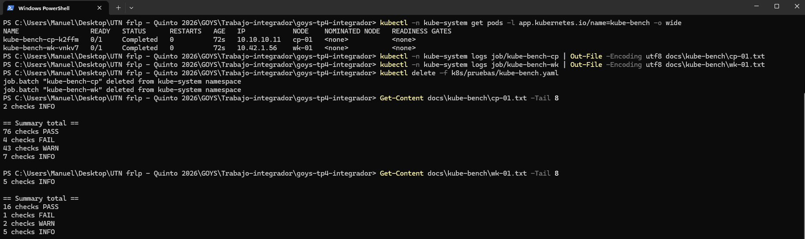

# Auditoría CIS con kube-bench (M12)

**Responsable:** Manuel Rebol · **Fecha:** 16/11/2026 · **Tarea:** M12 (#52)

**Listo cuando (M12, #52):** reporte en `docs/`, sin fallas críticas. Revisar qué FAIL son reales y cuáles no aplican a RKE2.

El cluster se instaló con el perfil `cis` de RKE2 ([etapa 5](05-cluster.md)). kube-bench comprueba ese perfil contra el CIS Kubernetes Benchmark: lee los archivos y procesos de los nodos y consulta la API.

## Cómo se corrió

| Pieza | Elección | Motivo |
|-------|----------|--------|
| Herramienta | kube-bench v0.16.0, imagen `docker.io/aquasec/kube-bench:v0.16.0` | Última versión. El sha256 del binario publicado coincide con el `checksums.txt` del release |
| Benchmark | `rke2-cis-1.9` | El más nuevo para RKE2 que trae kube-bench. Ajusta las rutas y las excepciones propias de RKE2. Es anterior a Kubernetes 1.36, así que algunos controles no aplican (abajo) |
| Dónde | Dos Jobs en `kube-system`: `cp-01` (master, etcd, control plane, nodo y políticas) y `wk-01` (nodo) | `kube-system` es el único namespace sin Pod Security `restricted`, y kube-bench necesita `hostPID` y leer archivos del nodo. Montajes de solo lectura |
| Cómo | Manifiesto [`k8s/pruebas/kube-bench.yaml`](../k8s/pruebas/kube-bench.yaml), aplicado a mano y borrado al terminar | Es una auditoría puntual, como las pruebas de R14 y N07: ArgoCD no lee `k8s/pruebas/`, y no queda nada corriendo |

```powershell
kubectl apply -f k8s/pruebas/kube-bench.yaml
kubectl -n kube-system wait --for=condition=complete job/kube-bench-cp job/kube-bench-wk --timeout=300s
kubectl -n kube-system logs job/kube-bench-cp | Out-File -Encoding utf8 docs\kube-bench\cp-01.txt
kubectl -n kube-system logs job/kube-bench-wk | Out-File -Encoding utf8 docs\kube-bench\wk-01.txt
kubectl delete -f k8s/pruebas/kube-bench.yaml
```

kube-bench solo dice que un control de políticas falla, no qué objeto falla. [`detalle-5.1.ps1`](kube-bench/detalle-5.1.ps1) aplica la misma lógica que los controles 5.1.3, 5.1.5 y 5.1.6 y lista los objetos; solo lee.

Reportes completos: [`cp-01.txt`](kube-bench/cp-01.txt), [`wk-01.txt`](kube-bench/wk-01.txt) y [`detalle-5.1.txt`](kube-bench/detalle-5.1.txt). No tienen secretos: solo nombres de controles, objetos y remediaciones.

## Resultado

| Nodo | Sección | PASS | FAIL | WARN | INFO |
|------|---------|-----:|-----:|-----:|-----:|
| `cp-01` | 1. Control plane (master) | 51 | 0 | 8 | 0 |
| `cp-01` | 2. etcd | 7 | 0 | 0 | 0 |
| `cp-01` | 3. Configuración del control plane | 1 | 0 | 4 | 0 |
| `cp-01` | 4. Nodo | 16 | 1 | 2 | 5 |
| `cp-01` | 5. Políticas | 1 | 3 | 29 | 2 |
| `cp-01` | **Total** | **76** | **4** | **43** | **7** |
| `wk-01` | 4. Nodo | 16 | 1 | 2 | 5 |



**Sin fallas críticas.** El control plane, etcd y la configuración de los nodos pasan todos los controles automáticos. De los 5 FAIL, 2 no aplican a este cluster, 1 se corrigió y 2 son permisos que ArgoCD necesita para funcionar.

### FAIL

| Control | Dónde | Qué encontró | Clasificación | Qué se hizo |
|---------|-------|--------------|---------------|-------------|
| 4.3.1 Métricas de kube-proxy solo en `localhost` | `cp-01` y `wk-01` | No hay proceso `kube-proxy` | **No aplica** | Nada. El cluster no tiene kube-proxy: Cilium lo reemplaza (`disable-kube-proxy: true`, [etapa 5](05-cluster.md#configuración)). kube-bench no encuentra el proceso ni su configuración y lo da por fallado |
| 5.1.5 La cuenta `default` de cada namespace no se usa | Cluster | La cuenta `default` monta token por defecto en `app`, `cloudflared`, `gateway`, `argocd` y `cilium-secrets` | **Real, riesgo bajo**: ningún pod de esos namespaces usa la cuenta `default` con token (5.1.6 no los lista) | **Corregido** en los namespaces del grupo: `automountServiceAccountToken: false` en la cuenta `default` de `app`, `cloudflared` y `gateway`, aplicado por ArgoCD ([`app`](../k8s/app/serviceaccount-default.yaml), [`cloudflared`](../k8s/cloudflared/serviceaccount-default.yaml), [`gateway`](../k8s/gateway-api/serviceaccount-default.yaml)). Quedan `argocd` (instalación de ArgoCD) y `cilium-secrets` (lo crea Cilium, sin pods) |
| 5.1.3 Comodines (`*`) en Roles y ClusterRoles | Cluster | ClusterRoles `argocd-application-controller` y `argocd-server` | **Real, aceptado**: son los de la instalación oficial de ArgoCD. El controller aplica cualquier tipo de recurso del repo y el server lo muestra y lo puede borrar desde la UI | Nada. Lo mitiga el acceso a ArgoCD: UI solo por WARP, usuario propio por integrante y `admin` deshabilitado (M18) |
| 5.1.6 Tokens montados solo donde hace falta | Cluster | Los 6 pods de `argocd` | **Real, aceptado**: el controller, el server, el applicationset-controller, notifications y dex hablan con la API. `argocd-redis` no la necesita | Nada por ahora. Sacarle el token a `argocd-redis` es un cambio a la instalación de ArgoCD; queda como mejora. `app` y `cloudflared` ya tenían `automountServiceAccountToken: false` en sus pods y no aparecen |

### WARN

Los WARN son controles *Manual*: kube-bench no los puede decidir solo y quedan para el operador. Agrupados:

| Controles | Tema | Estado en este cluster |
|-----------|------|------------------------|
| 1.1.8, 1.1.9, 1.1.10, 1.1.12, 1.1.20 | Permisos y dueño de archivos de etcd, CNI y PKI | kube-bench no los comprueba en RKE2. Se revisan en el nodo; quedan para la matriz de evidencias (R23) |
| 1.2.3, 1.2.9, 1.2.11 | Admisión `DenyServiceExternalIPs`, `EventRateLimit`, `AlwaysPullImages` | No activados. Riesgo bajo: no hay usuarios externos que creen Services ni pods; N07 exige tags fijos o digest, así que una imagen en caché no se reemplaza por otra con el mismo nombre |
| 3.1.1, 3.1.2, 3.1.3 | Usuarios con certificados cliente en lugar de OIDC | Cada integrante tiene su certificado (M14), que vence el 13/01/2027 y solo se usa por WARP. OIDC queda como trabajo futuro |
| 3.2.2 | Alcance de la política de auditoría | El *audit log* del perfil `cis` está activo (3.2.1 PASS). Revisar su cobertura queda como mejora |
| 4.2.12, 4.2.13 (los dos nodos) | Cifrados TLS del kubelet y límite de PIDs por pod | No configurados. Se agregarían como `kubelet-arg` en la configuración de RKE2, por Ansible (R17); queda como mejora |
| 5.1.7 a 5.1.13 | Uso de permisos sensibles de RBAC | Revisión manual. Los integrantes tienen `cluster-admin` por certificado propio (M14) |
| 5.2.1 a 5.2.13 | Pods privilegiados, `hostPID`, root, capabilities, `hostPath` | **Cubierto**: Pod Security `restricted` en todo el cluster salvo `kube-system` ([R14](hardening.md#r14--pod-privilegiado-rechazado)) y la ValidatingAdmissionPolicy de N07 en `app` |
| 5.3.1, 5.3.2 | CNI con NetworkPolicies y políticas en todos los namespaces | Cilium las soporta. **Cubierto** en `app` y `cloudflared` ([R13](hardening.md#r13--networkpolicies-default-deny)); `argocd` tiene las de su instalación y `kube-system` las del perfil `cis` de RKE2 |
| 5.4.1, 5.4.2 | Secretos como archivos y almacenamiento externo | La contraseña de Redis llega como variable de entorno: es un WARN real, de riesgo bajo. Los secretos van cifrados en el repo con Sealed Secrets ([N08](hardening.md#n08--sealed-secrets-ningún-secreto-en-claro-en-el-repo)) |
| 5.5.1 | Procedencia de imágenes con `ImagePolicyWebhook` | Cubierto por otro camino: imágenes firmadas con cosign en el CI (N02) y N07 solo admite `ghcr.io` |
| 5.7.1 a 5.7.4 | Namespaces, seccomp, securityContext, no usar `default` | **Cubierto**: cada componente en su namespace, `RuntimeDefault` y securityContext los exige Pod Security `restricted` (R04, R14), y no hay nada en `default` |

## Pendiente

- Cuando ArgoCD aplique las cuentas `default` corregidas, correr de nuevo [`detalle-5.1.ps1`](kube-bench/detalle-5.1.ps1): en 5.1.5 tienen que quedar solo `argocd` y `cilium-secrets`.
- Mejoras para después de la Feria: token fuera de `argocd-redis` y cuenta `default` de `argocd` sin token (instalación de ArgoCD, M), y `tls-cipher-suites` y `pod-max-pids` en el kubelet (Ansible).
