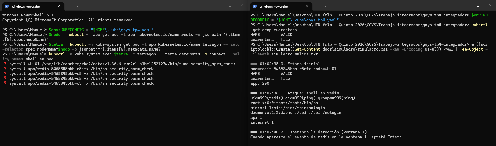
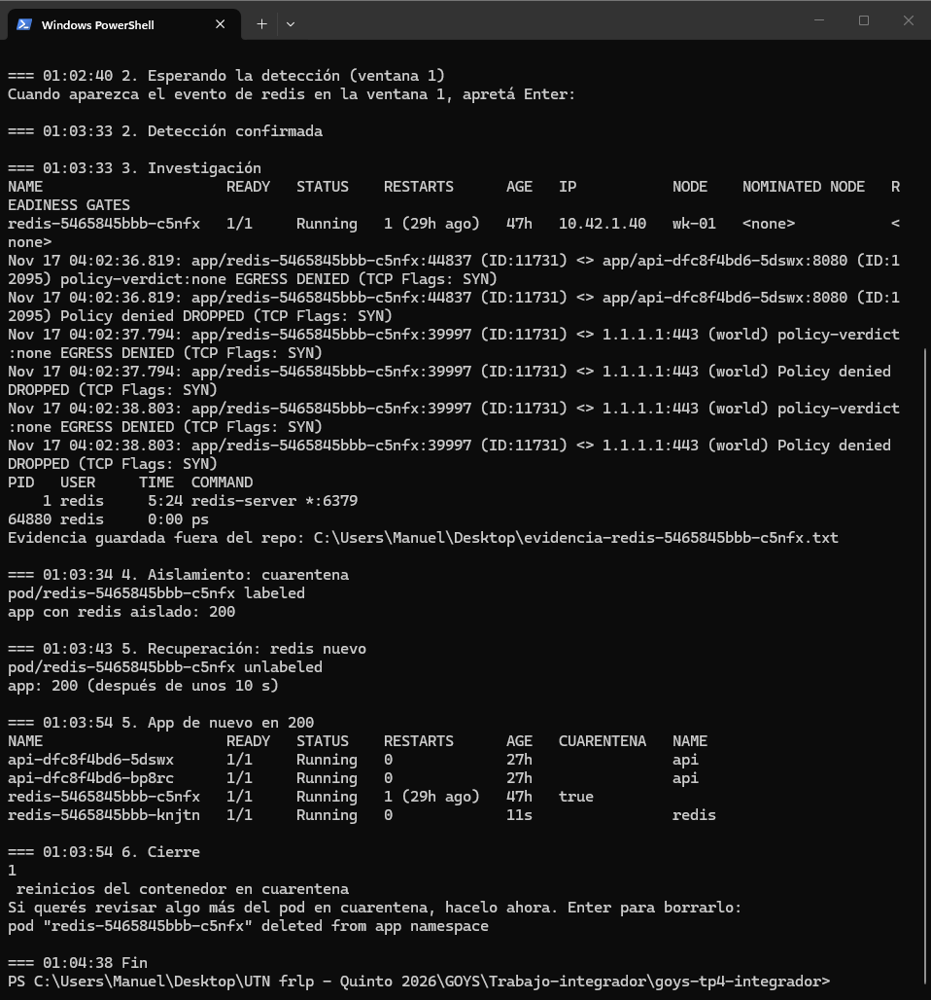

# Simulacro de incidente: detectar, aislar e informar (N06)

**Responsable:** Manuel Rebol · **Fecha:** 17/11/2026 · **Tarea:** N06 (#59) · **Depende de:** N05 ([Tetragon](hardening-tetragon.md)), R13 ([NetworkPolicies](hardening.md#r13--networkpolicies-default-deny))

**Listo cuando (N06, #59):** mini informe en `docs/` con línea de tiempo y capturas.

## Escenario

Alguien consigue una shell dentro del pod de `redis` (en el simulacro, con `kubectl exec`, que es lo que vería Tetragon si entrara por una vulnerabilidad). Desde ahí mira el sistema e intenta moverse a `api` y sacar datos a internet. El objetivo es detectarlo, cortarle la red al pod sin perder la evidencia, volver a dejar la app andando y dejar registro de lo que pasó.

## Piezas

| Fase | Con qué | Dónde está |
|------|---------|------------|
| Detectar | TracingPolicy `shell-en-pod` de Tetragon: una shell que arranca dentro de un pod | [hardening-tetragon.md](hardening-tetragon.md) (N05) |
| Investigar | Hubble: qué intentó hacer el pod y qué se bloqueó | [hardening.md](hardening.md#r15--flujo-bloqueado-en-hubble) (R13, R15) |
| Aislar | `CiliumClusterwideNetworkPolicy` `cuarentena`: corta toda la red de los pods con la etiqueta `goys.io/cuarentena=true` | [`k8s/cilium/cuarentena.yaml`](../k8s/cilium/cuarentena.yaml), aplicada por ArgoCD (`cilium-politicas`) |
| Recuperar | Sacar el pod del Deployment: el ReplicaSet crea uno limpio | Comandos abajo |

La política de cuarentena está en git desde antes del incidente y no selecciona nada hasta que se etiqueta un pod. Durante el incidente no se aplica ningún manifiesto a mano: solo se cambian etiquetas de un pod, que ArgoCD no controla, así que no hace falta pausar el auto-sync ([runbook de ArgoCD](runbook-argocd.md#pausar-el-auto-sync)).

## Procedimiento

Con WARP conectado. Ventana 1, la "alarma" (queda abierta todo el simulacro):

```powershell
$env:KUBECONFIG = "$HOME\.kube\goys-tp4.yaml"
$nodo = kubectl -n app get pod -l app.kubernetes.io/name=redis -o jsonpath='{.items[0].spec.nodeName}'
$tetra = kubectl -n kube-system get pod -l app.kubernetes.io/name=tetragon --field-selector spec.nodeName=$nodo -o jsonpath='{.items[0].metadata.name}'
kubectl -n kube-system exec $tetra -c tetragon -- tetra getevents -o compact --policy-names shell-en-pod
```

Ventana 2: [`simulacro.ps1`](simulacro/simulacro.ps1) hace el ataque y la respuesta, y anota la hora de cada paso:

1. **Ataque:** shell en `redis`: `id`, lectura de `/etc/passwd`, intento a `api:8080` y a `1.1.1.1:443`.
2. **Detección:** el script espera hasta que se confirma el evento en la ventana 1.
3. **Investigación:** pod, nodo y flujos descartados por Hubble. Se guarda la descripción del pod como evidencia.
4. **Aislamiento:** `kubectl label pod <pod> goys.io/cuarentena=true`. El script espera a que Cilium le cambie la identidad al pod (recién ahí corta la red; ver la línea de tiempo) y comprueba que `api` ya no le llega.
5. **Recuperación:** se le saca la etiqueta `app.kubernetes.io/name` al pod. El ReplicaSet deja de reconocerlo y crea un `redis` nuevo; el script espera a que la app vuelva a responder `200`.
6. **Cierre:** se borra el pod en cuarentena.

## Línea de tiempo

Simulacro del 17/11/2026, de madrugada (hora de Argentina; Hubble muestra UTC, 3 horas más). Salida completa: [`salida-17-11.txt`](simulacro/salida-17-11.txt); flujos del pod en cuarentena: [`hubble-17-11.txt`](simulacro/hubble-17-11.txt).

| Hora | Fase | Qué pasó |
|------|------|----------|
| 01:02:35 | Antes | App en `200`; política `cuarentena` en el cluster (`VALID True`) |
| 01:02:36 | Ataque | Shell en `redis-5465845bbb-c5nfx` (`wk-01`): `id`, lectura de `/etc/passwd`, conexión a `api:8080` y a `1.1.1.1:443` |
| 01:02:36 | Detección | Tetragon registra en el momento la shell y cada comando que corre (`/bin/sh` dentro de `app/redis-...`) |
| 01:02:36–38 | Contención (R13) | Los dos intentos de conexión se cortan solos: `EGRESS DENIED` hacia `api:8080` y hacia `1.1.1.1:443`. `redis` no tiene salida permitida |
| 01:03:33 | Detección confirmada | El operador ve el evento y arranca la respuesta: **57 s** después del ataque |
| 01:03:33 | Investigación | Pod y nodo; flujos descartados en Hubble; `ps` muestra solo `redis-server` (no quedó ningún proceso del atacante); descripción del pod guardada como evidencia, fuera del repo |
| 01:03:34 | Aislamiento | Etiqueta `goys.io/cuarentena=true` |
| 01:03:40 | — | `api` → `redis` todavía `ALLOWED`: el pod conserva su identidad de Cilium (`11731`) y la cuarentena no lo alcanza todavía |
| 01:03:43 | Recuperación | Se le saca la etiqueta `app.kubernetes.io/name`; el ReplicaSet crea `redis-5465845bbb-knjtn` |
| \~01:03:53 | Servicio restablecido | La app vuelve a `200` con el `redis` nuevo, unos 10 s después. **1 min 17 s** desde el ataque |
| 01:03:58 | Aislamiento efectivo | Primer `Policy denied by denylist` sobre el pod en cuarentena, ya con identidad nueva (`15183`): todo lo que le llega se descarta, incluidas las probes del kubelet |
| 01:04:38 | Cierre | Pod en cuarentena borrado |





Extracto de Hubble del pod en cuarentena (UTC):

```text
04:03:40.040: app/api-dfc8f4bd6-5dswx:55120 (ID:12095) -> app/redis-5465845bbb-c5nfx:6379 (ID:11731) policy-verdict:L3-L4 INGRESS ALLOWED (TCP Flags: SYN)
04:03:58.774: 10.42.1.211:43314 (host) <> app/redis-5465845bbb-c5nfx:6379 (ID:15183) policy-verdict:all INGRESS DENIED (TCP Flags: SYN)
04:03:58.774: 10.42.1.211:43314 (host) <> app/redis-5465845bbb-c5nfx:6379 (ID:15183) Policy denied by denylist DROPPED (TCP Flags: SYN)
```

## Informe

**Resumen.** Una shell dentro de `redis` se detectó en el momento y no llegó a ningún lado: las NetworkPolicies ya le cortaban la salida. El pod quedó aislado y reemplazado por uno limpio, con la app de nuevo en `200` a 1 min 17 s del ataque.

| | |
|---|---|
| **Impacto** | Ningún dato salió del cluster ni llegó a `api` (R13). Unos 10 s de errores en la app durante el cambio de `redis`. Se perdieron los mensajes del libro de visitas: Redis guarda en `emptyDir` (R02) y el pod nuevo arranca vacío |
| **Causa** | Simulada: `kubectl exec` con un usuario administrador. En un caso real sería una vulnerabilidad en Redis o una credencial filtrada |
| **Qué funcionó** | Tetragon detectó la shell y cada comando sin configurar nada más. R13 contuvo el ataque antes de cualquier respuesta humana. La cuarentena estaba en git desde antes y no hubo que aplicar nada a mano ni pausar ArgoCD. `ps` y la descripción del pod se guardaron antes de aislarlo |
| **Qué no** | **La cuarentena no es instantánea:** corta recién cuando Cilium le asigna al pod la identidad nueva, entre 6 y 24 s después de etiquetarlo. En ese lapso `api` siguió hablando con el pod. El script original seguía a los 5 s y daba por aislado un pod que no lo estaba. **La detección depende de que alguien mire:** los 57 s hasta la confirmación son el tiempo de ver la ventana de Tetragon |
| **Qué se cambió** | El paso 4 del [script](simulacro/simulacro.ps1) ahora espera a que cambie la identidad de Cilium del pod y muestra cuánto tardó, antes de seguir |
| **Para después** | Avisos automáticos de Tetragon (exportar los eventos a un canal del grupo) en lugar de mirar una terminal. Redis con persistencia o réplica, para no perder datos al reemplazar el pod. Evaluar que Tetragon mate la shell (`Sigkill`) además de registrarla |

Con la cuarentena, la liveness del pod (cada 20 s, contra el puerto de Redis) también falla, así que después de tres fallas seguidas (alrededor de un minuto) el kubelet reiniciaría el contenedor y se perdería lo que hubiera en memoria. Por eso la evidencia se junta antes de aislar.
