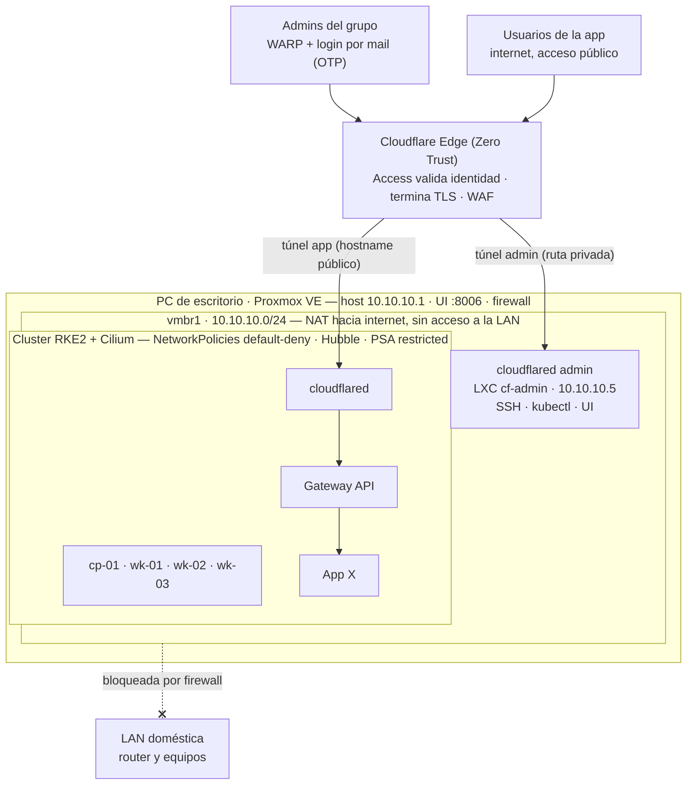

# Kubernetes en casa sin abrir puertos: un cluster RKE2 sobre Proxmox con acceso Zero Trust

> Propuesta de proyecto — TP N.º 4, Gestión Operativa y Seguridad en Redes · UTN FR La Plata
> Versión en PDF: [`propuesta.pdf`](propuesta.pdf)

| | |
|---|---|
| **Grupo** | Grupo 12 |
| **Modalidad** | A — Proyecto de Desarrollo |
| **Muestra** | Feria de Redes, GOYS '26 — 17 de noviembre de 2026, La Plata, Argentina |

**Integrantes**

| Nombre | Mail |
|--------|------|
| Facundo Serra | facundoserra@alu.frlp.utn.edu.ar |
| Martín Espamer | martinespamer@alu.frlp.utn.edu.ar |
| Agustín Manrique | agustinmanrique@alu.frlp.utn.edu.ar |
| Baltazar Molteni | baltazarmolteni@alu.frlp.utn.edu.ar |
| Manuel Rebol | manuelrebol@alu.frlp.utn.edu.ar |

---

*Figura 1: Arquitectura propuesta. Los dos túneles son conexiones **salientes** hacia Cloudflare, por lo que el router no abre ningún puerto; la red de las VMs (vmbr1) no puede alcanzar la LAN de la casa.*

## Resumen

¿Se puede operar un cluster Kubernetes "de verdad" desde una PC de escritorio en casa, publicar una aplicación en internet y administrarlo de forma remota, sin abrir un solo puerto en el router? Este trabajo propone hacerlo: un cluster RKE2 de cuatro nodos (un *control plane* y tres *workers*) virtualizado sobre Proxmox VE, en una red interna aislada de la LAN doméstica. La aplicación se publica mediante un Cloudflare Tunnel y la administración se restringe con Cloudflare Zero Trust (Access + cliente WARP), de modo que todo acceso se decide por identidad y no por ubicación en la red [1]. El proyecto integra las tres áreas de la materia: redes (bridges, NAT, segmentación, Gateway API, CNI Cilium basado en eBPF), operación (Ansible, cloud-init, *runbooks*) y seguridad (perfil CIS, Pod Security Admission, NetworkPolicies *default-deny*, escaneo de imágenes). Cada control de seguridad viene acompañado de una prueba que lo demuestra, y esas pruebas son el corazón de la demo que presentaremos en la Feria de Redes.

**Palabras clave:** Kubernetes, RKE2, Proxmox VE, Zero Trust, Cloudflare Tunnel, Cilium, eBPF, Gateway API, hardening CIS.

## 1. Introducción

Exponer un servicio desde una red hogareña suele resolverse abriendo puertos en el router (*port forwarding*). Esa solución tiene dos problemas: muchas conexiones residenciales están detrás de CGNAT y directamente no la permiten, y cuando funciona deja al equipo expuesto a todo internet, con la red de la casa como único "perímetro". El modelo Zero Trust [1] invierte el enfoque: ningún acceso es confiable por venir de "adentro"; cada pedido se autentica y autoriza por identidad.

Nuestra propuesta lleva esa idea a un laboratorio concreto y reproducible. Sobre una PC de escritorio con 16 GB de RAM instalamos Proxmox VE [2] en *dual boot* con el Windows 11 existente, levantamos un cluster Kubernetes RKE2 [3] y publicamos una aplicación propia ("App X") a través de Cloudflare Tunnel [4]. El objetivo es académico: aprender y demostrar, con evidencia, gestión operativa y seguridad en redes. Los aportes del proyecto son:

- Un diseño de red con **segmentación en tres niveles**: LAN doméstica ↔ red de VMs ↔ tráfico entre pods.
- **Cero puertos abiertos**: tanto la app como la administración entran por túneles salientes, separados entre sí.
- Un **cluster reconstruible**: plantillas cloud-init y playbooks de Ansible permiten destruirlo y recrearlo.
- Una **matriz de verificación** donde cada medida de seguridad tiene una prueba observable.

## 2. Arquitectura

La Figura 1 resume la solución. El host Proxmox tiene dos bridges: **vmbr0**, sobre la placa física y conectado a la LAN de la casa, que solo usa el host; y **vmbr1**, un bridge interno `10.10.10.0/24` sin placa física, donde viven las VMs, y desde el cual el host hace NAT (*masquerade*) hacia internet. Si alguien compromete la app, queda encerrado en esa subred. La Tabla 1 muestra el reparto de recursos: unos 15,5 GB asignados de 16 GB, apoyados en *ballooning* y KSM de Proxmox.

Tabla 1: Recursos y direccionamiento del laboratorio.

| Máquina | Rol | vCPU | RAM | IP (vmbr1) |
|---------|-----|------|-----|------------|
| Host | Proxmox VE | — | ~2 GB | `10.10.10.1` |
| cf-admin | LXC, túnel admin | 1 | 512 MB | `10.10.10.5` |
| cp-01 | *control plane* | 2 | 4 GB | `10.10.10.11` |
| wk-01..03 | *workers* (×3) | 2 | 3 GB | `10.10.10.21-23` |

### 2.1. Flujo de datos

**Usuario de la app.** El navegador resuelve el hostname público, que apunta a Cloudflare. El borde termina TLS, aplica WAF y reenvía el pedido por el túnel de la app, una conexión saliente que mantiene `cloudflared` (Deployment con 2 réplicas dentro del cluster). Desde ahí, el pedido pasa por la Gateway API implementada por Cilium [5], [6] hasta los pods de App X, siempre que las NetworkPolicies lo permitan.

**Administrador.** Con el cliente WARP enrolado y una política de Access por mail del grupo + OTP, el tráfico viaja por el túnel admin hasta el LXC `cf-admin`, que publica una **ruta privada** hacia `10.10.10.0/24` sin hostname público. Así se llega a la UI de Proxmox (`:8006`), a SSH de los nodos y a `kubectl` contra `10.10.10.11:6443` como si se estuviera en la LAN. Que los túneles estén separados implica que, si el cluster se cae, la administración sigue disponible, y que si se compromete la app su túnel no tiene rutas hacia la administración.

## 3. Integración de las tres áreas

La Tabla 2 muestra cómo el proyecto cubre las áreas de la materia que exige la Modalidad A. Ninguna es decorativa: cada una tiene un entregable que se puede mostrar en la estación.

Tabla 2: Cobertura de las áreas Redes, Operación y Seguridad.

| Área | Qué implementamos |
|------|-------------------|
| Redes | Bridges Linux y NAT en Proxmox, red aislada `10.10.10.0/24`, firewall entre segmentos, CNI Cilium (eBPF), Gateway API, túneles salientes hacia Cloudflare. |
| Operación | Plantilla de VM con cloud-init, playbooks de Ansible para nodos y RKE2, *runbooks* de los procedimientos habituales. |
| Seguridad | Zero Trust (Access + WARP), RKE2 con perfil CIS [7], cifrado de Secrets, Pod Security Admission [8], NetworkPolicies *default-deny*, Hubble, Trivy. |

## 4. Stack tecnológico

Buscamos herramientas que sean Kubernetes "real" y que aporten material de seguridad sin que la instalación se coma el proyecto (Tabla 3).

Tabla 3: Stack elegido, justificación y alternativas descartadas.

| Capa | Elección | Por qué | Descartado |
|------|----------|---------|------------|
| Hipervisor | Proxmox VE | Bare-metal: casi toda la RAM va a las VMs; trae bridges y firewall propios. | Hyper-V / VMware sobre W11 (Windows consume 4–6 GB) |
| SO de nodos | Ubuntu Server 24.04 LTS | Soportado por RKE2, imagen cloud-init, mucha documentación. | — |
| Kubernetes | RKE2 | Distribución *upstream*, perfil CIS de fábrica, etcd embebido, instalación por script. | kubeadm (muy manual), Rancher (pesado), k3s (plan B) |
| CNI | Cilium + Hubble | NetworkPolicies L3–L7 con eBPF y visibilidad del tráfico entre pods. | Canal (default de RKE2, sin visibilidad de flujos) |
| Exposición | Gateway API (Cilium) | Estándar actual; ingress-nginx fue retirado por el proyecto Kubernetes. | ingress-nginx |
| Acceso externo | Cloudflare Tunnel + Zero Trust | Sin puertos abiertos, funciona detrás de CGNAT, control por identidad, un solo panel. | Tailscale / WireGuard |
| Auditoría | kube-bench, Trivy | Chequeo CIS del cluster y escaneo de imágenes. | — |

## 5. Seguridad por capas

La seguridad no es un agregado final sino el eje del diseño. Aplicamos defensa en profundidad desde el router hasta el contenedor, y para cada capa definimos **cómo se verifica**, de forma que el informe y la demo muestren evidencia y no solo configuración (Tabla 4).

Tabla 4: Matriz de seguridad: medida por capa y prueba que la demuestra.

| Capa | Medida | Cómo lo verificamos |
|------|--------|---------------------|
| Perímetro | Ningún puerto abierto en el router; todo entra por Cloudflare. | Escaneo `nmap` a la IP pública desde afuera: sin puertos abiertos. |
| Host Proxmox | 2FA (TOTP) en la UI, SSH solo con clave, root sin login por contraseña. | Intentos de login sin 2FA y por contraseña: rechazados. |
| Red | vmbr1 aislada; firewall de Proxmox bloquea vmbr1 → `192.168.0.0/16`. | Desde una VM, `ping` a un equipo de la LAN: falla. |
| Acceso admin | Access + WARP con política por identidad (mail del grupo + OTP). | Sin WARP o con un mail ajeno al grupo: sin acceso. |
| Nodos | Ubuntu mínimo, SSH con clave, actualizaciones automáticas de seguridad. | Revisión de `sshd -T` y de `unattended-upgrades`. |
| Cluster | RKE2 con `profile: cis`, cifrado de Secrets en etcd, *audit log* del API server. | Reporte de kube-bench; `rke2 secrets-encrypt status`. |
| Workloads | Pod Security Admission en `restricted` para el namespace de la app. | Un pod privilegiado de prueba es rechazado. |
| Tráfico entre pods | NetworkPolicies *default-deny* por namespace; solo se abre lo necesario. | Hubble muestra los flujos bloqueados. |
| Imágenes y app | Escaneo con Trivy; contenedor no-root, *filesystem* de solo lectura, límites de recursos. | Reporte sin vulnerabilidades críticas; revisión del pod en ejecución. |
| Credenciales | Token de cada túnel como Secret de Kubernetes, nunca en Git. | Rotación del token documentada en un *runbook*. |

## 6. Gestión operativa

La parte operativa busca demostrar que el cluster se puede **reconstruir de forma reproducible**, no solo levantar una vez.

**Automatización.** Plantilla de VM con cloud-init para crear nodos idénticos en minutos y playbooks de Ansible para preparar nodos e instalar RKE2. *Runbooks*: alta de un nodo, *upgrade* de RKE2, y rotación del token del túnel.

## 7. Plan de trabajo y demo

El trabajo avanza en nueve etapas; cada una cierra con un criterio verificable antes de pasar a la siguiente (Tabla 5).

Tabla 5: Etapas del proyecto y criterio de cierre.

| # | Etapa | Listo cuando… |
|---|-------|---------------|
| 1 | Base | Proxmox instalado, UI con 2FA y SSH solo por clave. |
| 2 | Red | Una VM sale a internet y no llega a la LAN. |
| 3 | Acceso admin | Entramos a Proxmox desde fuera de casa sin puertos abiertos. |
| 4 | Nodos | 4 VMs desde plantilla, IP fija y SSH por clave. |
| 5 | Cluster | 4 nodos `Ready`; kube-bench sin fallas críticas. |
| 6 | Servicios base | Gateway API operativa; Hubble mostrando flujos. |
| 7 | App | App X accesible por su hostname público. |
| 8 | Hardening | Pruebas de bloqueo documentadas con capturas. |
| 9 | Operación | *Runbooks* documentados y demo ensayada. |

**Qué se verá en la estación.** La demo recorre la matriz de la Tabla 4 en vivo: (1) la app abierta desde su hostname público mientras un `nmap` a la IP de la casa no encuentra puertos; (2) la UI de Proxmox accesible con WARP y rechazada sin él; (3) un pod privilegiado rechazado por Pod Security Admission; y (4) Hubble mostrando en tiempo real el tráfico que las NetworkPolicies bloquean. Acompañan la estación el póster A1, el documento y el repositorio con configuraciones, playbooks y capturas.

## 8. Riesgos y limitaciones

El alcance excluye alta disponibilidad real (es un único host físico), uso productivo, capas de gestión gráfica como Rancher y cualquier servicio expuesto sin pasar por Cloudflare. La Tabla 6 resume los riesgos identificados.

Tabla 6: Riesgos principales y su mitigación.

| Riesgo | Mitigación |
|--------|------------|
| RAM justa (16 GB) | *Ballooning* y KSM; plan B con 2 *workers* o k3s, que reutiliza casi toda la configuración. |
| Particionar con BitLocker | Suspender BitLocker, backup previo y clave de recuperación a mano; idealmente, un disco aparte para Proxmox. |
| Dual boot | El cluster existe solo con la PC en Proxmox: se acuerdan horarios, no es un servicio 24/7. |
| Dependencia de Cloudflare | Acceso de emergencia al host desde la LAN de la casa. |
| Conectividad en la Feria | La demo depende de internet; respaldo con video grabado de cada prueba y capturas en el repositorio. |
| Filtración del token de un túnel | Token como Secret, fuera de Git, rotación documentada. |
| Cloudflare termina el TLS | Aceptado: el laboratorio no maneja datos sensibles. |

## 9. Resultados esperados

Al cierre esperamos contar con un cluster de cuatro nodos funcionando, publicado sin puertos abiertos y administrado por identidad; un conjunto de pruebas reproducibles que evidencien cada control de seguridad; y la capacidad de destruir y recrear todo el entorno con Ansible. El proyecto muestra que Zero Trust y la operación profesional son aplicables aun con los recursos de una PC hogareña.

## Referencias

1. S. Rose, O. Borchert, S. Mitchell, y S. Connelly, «Zero Trust Architecture (NIST SP 800-207)», 2020. doi: [10.6028/NIST.SP.800-207](https://doi.org/10.6028/NIST.SP.800-207).
2. Proxmox Server Solutions GmbH, «Proxmox VE Administration Guide». [En línea]. Disponible en: <https://pve.proxmox.com/pve-docs/>
3. SUSE Rancher, «RKE2 Documentation: CIS Hardening Guide». [En línea]. Disponible en: <https://docs.rke2.io/security/hardening_guide>
4. Cloudflare, «Cloudflare Tunnel and Cloudflare Access». [En línea]. Disponible en: <https://developers.cloudflare.com/cloudflare-one/>
5. Kubernetes SIG Network, «Gateway API». [En línea]. Disponible en: <https://gateway-api.sigs.k8s.io/>
6. Cilium Project, «Cilium and Hubble Documentation». [En línea]. Disponible en: <https://docs.cilium.io/>
7. Center for Internet Security, «CIS Kubernetes Benchmark», 2024. [En línea]. Disponible en: <https://www.cisecurity.org/benchmark/kubernetes>
8. The Kubernetes Authors, «Pod Security Standards». [En línea]. Disponible en: <https://kubernetes.io/docs/concepts/security/pod-security-standards/>
